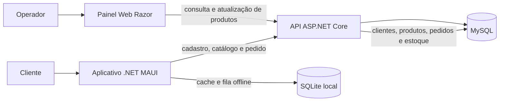

# Especificação do projeto — Loja de Produtos de Limpeza

## 1. Contexto e objetivo

O sistema permite que um cliente se cadastre pelo aplicativo, consulte produtos de limpeza agrupados por categoria e envie pedidos com quantidades. O aplicativo móvel persiste dados localmente para manter o cadastro, o catálogo em cache e pedidos ainda não sincronizados. A API centraliza as regras de validação e persiste os dados no MySQL. O painel web, implementado com Razor Pages, apresenta os mesmos clientes, produtos, estoque e pedidos.

O projeto atende ao exercício de integração Web e Mobile. Não há autenticação/login neste escopo. O cadastro de cliente é obrigatório antes do primeiro pedido.

## 2. Atores

| Ator | Responsabilidade |
|---|---|
| Cliente | Cadastra seus dados, consulta o catálogo, monta e envia pedidos pelo app. |
| Operador da loja | Consulta pedidos e clientes no painel web, atualiza preço/estoque e ativa ou inativa produtos. |
| Aplicativo MAUI | Mantém dados locais, sincroniza catálogo e envia pedidos à API. |
| API | Valida os dados, aplica preço e estoque vigentes e grava as operações no MySQL. |

## 3. Requisitos funcionais

| ID | Requisito |
|---|---|
| RF01 | No primeiro uso, exigir cadastro de cliente pessoa física (CPF) ou jurídica (CNPJ). |
| RF02 | Salvar o cadastro localmente antes de tentar a sincronização para permitir uso sem conexão. |
| RF03 | Consultar categorias e produtos pela API e armazenar uma cópia local no SQLite. |
| RF04 | Atualizar o catálogo ao abrir a área de pedido se a última sincronização tiver mais de cinco minutos, e oferecer atualização manual. |
| RF05 | Exibir produtos ativos por categoria, com nome, código, unidade, preço e estoque informado pelo servidor. |
| RF06 | Permitir adicionar quantidades inteiras ao carrinho, remover itens e visualizar subtotal e total. |
| RF07 | Salvar o pedido e seus itens no SQLite antes do envio à API. |
| RF08 | Manter pedidos sem conexão como pendentes e tentar sincronizá-los novamente quando o app consultar a API. |
| RF09 | Mostrar no app o histórico local do cliente e o status de sincronização. |
| RF10 | A API disponibilizar clientes, categorias, produtos e pedidos ao painel web. |
| RF11 | O painel Razor apresentar listas de pedidos, clientes e produtos, além de estoque e situação do produto. |
| RF12 | O painel atualizar os dados automaticamente a cada 15 segundos e permitir atualização manual. |
| RF13 | Permitir ao operador alterar preço, estoque e situação ativa/inativa de um produto pelo painel. |

## 4. Regras de negócio

| ID | Regra |
|---|---|
| RN01 | Um pedido sempre pertence a um cliente previamente cadastrado na API. |
| RN02 | CPF é exigido para PF e CNPJ para PJ; os dígitos verificadores são validados. Pontuação é removida antes de persistir. |
| RN03 | Nome, endereço e identificador externo do cliente são obrigatórios; telefone e e-mail são opcionais. |
| RN04 | O pedido deve possuir ao menos um item; quantidades são inteiras entre 1 e 9.999 e um produto não pode aparecer em linhas repetidas. |
| RN05 | Produtos inativos não são exibidos para compra e são rejeitados pela API caso um pedido antigo tente enviá-los. |
| RN06 | Preço, estoque e status retornados pelo MySQL são a referência no momento do envio. O valor salvo offline é uma estimativa baseada no catálogo em cache. |
| RN07 | A API não aceita quantidade maior que o estoque disponível. A validação e a baixa do estoque ocorrem dentro da mesma transação MySQL. |
| RN08 | O subtotal é quantidade × preço unitário; valores são arredondados para duas casas decimais com `MidpointRounding.AwayFromZero`. |
| RN09 | O identificador GUID externo do pedido torna novas tentativas idempotentes: o mesmo pedido não gera uma segunda venda nem uma segunda baixa de estoque. |
| RN10 | Ao concluir o pedido, a API armazena no item o nome, código, unidade, quantidade e preço vigentes para preservar o histórico mesmo que o cadastro do produto mude. |
| RN11 | Produtos inativados continuam no catálogo sincronizado, mas não aparecem na consulta de compra do app. Assim, a atualização propaga inativação sem apagar histórico. |

## 5. Fluxo das aplicações



### 5.1 Aplicativo

1. Ao iniciar, consulta o SQLite. Sem cliente local, abre o formulário de cadastro e impede o acesso à tela de pedido até salvar.
2. Grava o cliente com um `ExternalId` GUID no SQLite. Havendo conexão, envia o cadastro à API e guarda o ID central retornado; sem conexão, mantém o cadastro pendente.
3. Consulta categorias e produtos. A API retorna também produtos inativos; o app sincroniza seu estado, mas lista apenas produtos ativos.
4. No pedido, o cliente seleciona a categoria, informa quantidades, adiciona/remove itens e confirma o total local.
5. O app grava pedido e itens no SQLite. Em seguida, tenta sincronizar cliente e pedidos pendentes em ordem de criação.
6. A API confirma cadastro de cliente, preço e estoque. O status/total retornados atualizam o pedido local. Se houver falha de conexão, o pedido fica como pendente.

### 5.2 Site e API

1. O painel Razor solicita os três conjuntos de dados à API ao abrir e a cada 15 segundos.
2. A API lê dados do MySQL e os entrega em JSON ao site e ao app.
3. Ao editar preço, estoque ou situação ativa, o painel envia `PUT /api/produtos/{id}`.
4. Ao receber pedido, a API valida os itens e o cliente, lê produtos bloqueando as linhas de estoque, calcula os valores com os preços centrais, grava pedido/itens e baixa o estoque em uma transação.

## 6. Dados e atributos

| Entidade/tabela | Atributos principais | Relacionamentos |
|---|---|---|
| Categoria | `Id`, `Nome` | Uma categoria possui muitos produtos. |
| Produto | `Id`, `Codigo`, `Nome`, `UnidadeMedida`, `PrecoUnitario`, `Estoque`, `CategoriaId`, `Ativo`, `AtualizadoEmUtc` | Pertence a uma categoria; mantém histórico nos itens do pedido. |
| Cliente | `Id`, `ExternalId`, `Nome`, `Documento`, `TipoPessoa`, `Telefone`, `Email`, `Endereco`, `CriadoEmUtc` | Um cliente possui muitos pedidos. |
| Pedido | `Id`, `ExternalId`, `ClienteId`, `CriadoEmUtc`, `Status`, `ValorTotal` | Pertence a cliente e possui itens. |
| ItemPedido | `Id`, `PedidoId`, `ProdutoId`, `CodigoProduto`, `NomeProduto`, `UnidadeMedida`, `Quantidade`, `PrecoUnitario` | Pertence a pedido e referencia produto; campos de descrição/preço são snapshots. |

SQLite mantém versões locais de cliente, categoria, produto, pedido e item de pedido. Valores monetários locais são guardados em centavos (`long`) para evitar imprecisão binária.

## 7. Tecnologias e ambiente técnico

| Parte | Tecnologias e função |
|---|---|
| App Android | C#, .NET MAUI, XAML; SQLite local; `HttpClient` para API. Emulador Android acessa o host por `10.0.2.2`. |
| App iOS | Mesmo projeto .NET MAUI; compilação e execução requerem macOS e Xcode. O endereço da API depende do simulador/rede configurada. |
| App Windows | Mesmo projeto .NET MAUI; API local em `localhost:5256`. |
| API | ASP.NET Core Web API no .NET 10; contratos e regras puras compartilhados com app e testes. |
| Site | Razor Pages hospedado no projeto da API; JavaScript consulta JSON da API e atualiza as tabelas. |
| Banco central | MySQL 8 ou compatível; `MySqlConnector`; uma transação protege gravação de pedido e estoque. |
| Banco local | SQLite criado no diretório de dados privado do app. |
| Testes | xUnit no projeto `LojaLimpeza.Tests`; testes de regras compartilhadas sem dependência de servidor. |

## 8. API HTTP

Os corpos JSON usam nomes camelCase. Falhas de validação retornam HTTP 400; conflitos de estoque/documento retornam HTTP 409; atualização de produto inexistente retorna 404.

| Método e rota | Uso |
|---|---|
| `GET /api/health` | Verificar disponibilidade da aplicação. |
| `GET /api/categorias` | Listar categorias ativas do catálogo. |
| `GET /api/produtos` | Listar produtos ativos para compra. |
| `GET /api/produtos?incluirInativos=true` | Sincronizar o catálogo completo, incluindo inativos, para o SQLite. |
| `PUT /api/produtos/{id}` | Atualizar preço, estoque e estado ativo. Corpo: `{ "precoUnitario": 10.5, "estoque": 20, "ativo": true }`. |
| `GET /api/clientes` | Listar clientes para o painel web. |
| `POST /api/clientes` | Cadastrar/sincronizar cliente. |
| `GET /api/pedidos` | Listar pedidos, itens e clientes para o app/painel. |
| `POST /api/pedidos` | Criar pedido idempotente e baixar o estoque. |

Exemplo de pedido:

```json
{
  "externalId": "2a50b66d-4e53-4e08-9c58-776fdc5aa8c1",
  "clienteId": 1,
  "itens": [{ "produtoId": 1, "quantidade": 2 }]
}
```

## 9. Escopo e limitações atuais

- Não há login, autorização por perfil, pagamento real, emissão fiscal, entrega ou cancelamento de pedido; não foram pedidos na especificação do professor para este projeto.
- O painel não cadastra clientes: os registros aparecem após cadastro/sincronização pelo app.
- O banco é criado pelo script SQL e as tabelas/dados iniciais pela API. A sincronização depende do servidor e MySQL estarem acessíveis.
- Os produtos de demonstração são criados uma vez; mudanças feitas no painel não são sobrescritas nas inicializações seguintes.
